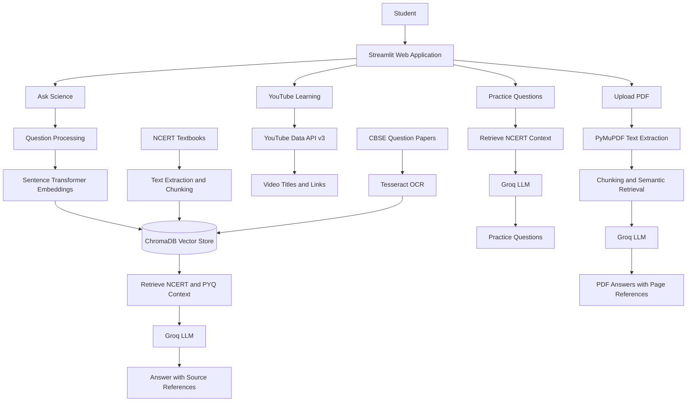

# Science RAG Project Architecture

## Overview

The Science RAG application helps students learn Class 10 Science using NCERT textbook content, previous-year question papers (PYQs), practice questions, YouTube learning resources, and uploaded PDF documents.

## System Architecture

## Main Components

- **Frontend:** Streamlit web application.
- **Document processing:** Text extraction from NCERT textbooks and OCR processing for scanned question papers.
- **Embeddings:** Sentence Transformers (`all-MiniLM-L6-v2`).
- **Vector database:** ChromaDB for storing and retrieving document chunks.
- **Retrieval-Augmented Generation:** Relevant context is retrieved and passed to the Groq LLM to generate answers.
- **Practice questions:** Generates topic-based questions using NCERT context.
- **YouTube integration:** Uses the YouTube Data API v3 to find relevant learning videos.
- **PDF question answering:** Extracts text from uploaded PDFs and answers questions using relevant document context.
- **Evaluation:** Tests retrieval and answer-pipeline behavior using predefined test cases.

## Evaluation Results

- Total test cases: 6
- Retrieval checks passed: 6/6 (100%)
- Answer pipeline returned text: 6/6 (100%)
- Detailed results: `evaluation/rag_evaluation_results.csv`

These results validate the current test cases; they do not by themselves establish factual answer accuracy.

## Limitations

- Scanned PDFs may require OCR before their text can be processed.
- Answer quality depends on document quality, retrieval relevance, and LLM output.
- YouTube results depend on API availability and configuration.
